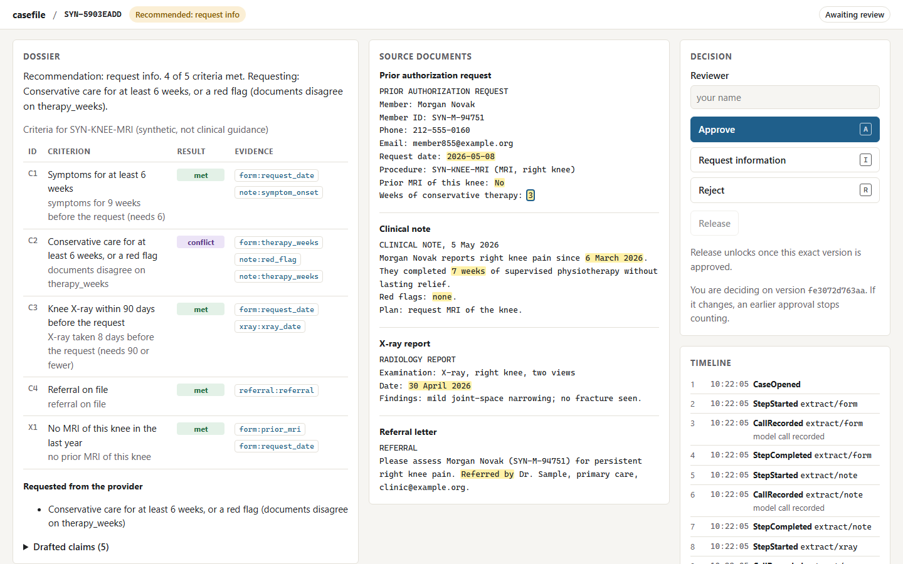

# casefile

**An AI review workflow you can kill mid-thought, cap at a budget, and never talk into an approval.**

casefile reviews prior-authorization cases (a doctor asking an insurer to approve an MRI) with
language-model helpers, and it's built around the parts agent demos leave out:

- What happens when the process dies halfway?
- Who pays for the call that was in flight?
- What stops a model from approving something because a document told it to?
- Who actually makes the decision?

Everything here runs on synthetic cases. No real patient or claim data is used anywhere, and the
criteria are invented, not clinical guidance.



## What it does

- **Survives crashes.** Every step is an event in an append-only log, so after a crash the case
  replays from its log and carries on exactly where it stopped.
- **Never decides with the model.** The model reads documents and drafts text. A small rules engine
  makes the recommendation, and a human makes the decision.
- **Checks every fact against its source.** Each fact the model reports has to quote the document.
  A check outside the model rejects anything the document doesn't say, and adds anything the model
  left out.
- **Binds approval to what the reviewer saw.** An approval is tied to the hash of that exact dossier.
  Change one word and it no longer counts.
- **Stops at a budget.** Call and cost limits are checked before every step, including calls lost
  in a crash. A case that hits its limit goes to a person, never to "approved".
- **Runs on any model, or none.** It ships with an offline stand-in. Two environment variables
  switch it to OpenRouter, Claude, or any OpenAI-compatible server ([how](docs/MODELS.md)).

## What I can show

Every number here comes from a command in this repository, and CI runs the tests behind them on every push.

| Claim | How it's measured | Result |
|---|---|---|
| A case resumes correctly after a kill at any point | `scripts/crash_matrix.py` kills real processes at every crash point of the real workflow | **32 of 32** crash points resume to the uninterrupted result (17 of 17 on a small toy case) |
| Nothing is released without a matching approval | Hypothesis property test plus an independent statement of the rule (`tests/test_release_properties.py`) | **none found** in 300 generated sequences of review events per run |
| A hijacked model can't win an approval | Attacks from a security review, kept as tests (`tests/test_injection.py`) | **0** approvals, both by forged quotes and by omitting facts |
| A run stops at its budget with a reason | Budget tests (`tests/test_agents.py`) | every limit stops **before** the step that would break it |
| Quality per dollar: specialists vs a single agent vs a fixed workflow | `scripts/compare.py` on the same cases and model | **not measured yet**: it needs a model key. About $0.05 for 27 cases × 3 designs on the default OpenRouter model |

## The journey

This is how it came together, including the parts that went wrong. Each section is a problem and
how I solved it.

### 1. "Recovery is replay." Then I killed it 32 times to prove it.

A case's state isn't stored anywhere. It's recomputed from the case's events every time it's read.
Model answers go into the log too, so replaying a case never calls the model again.

Claiming that is easy; proving it took a harness. It runs the case once and records every point
where a crash would leave work half-done. Then, for each point, it starts a fresh process, kills it
there with `os._exit` (no cleanup, no flush, the closest thing to pulling the plug), resumes it in
a new process, and compares the log, the effects at the outside world and the hash chain with an
uninterrupted run.

On the real workflow that's 32 kills, and every one resumes to the same result. Adding a step
grows the matrix by itself, because the matrix is discovered, not written down.

### 2. Who pays for the call that was in flight?

Kill the process after the model answered but before the answer was saved, and the answer is
gone. The bill isn't. Most systems simply forget that call ever happened.

I borrowed the idea from write-ahead logging. Before a call goes out, the log records `CallStarted`
with an estimated cost; when the answer comes back, `CallRecorded` holds the real cost. If the
process dies in between, the start is still in the log, so the possibly-paid-for call is charged
against the budget. The crash matrix reports it as "lost calls charged".

The one place this errs, it errs on purpose. A crash just after `CallStarted` charges a call that
never went out. It can over-count, but it can never under-count, which is the right way round for
a budget.

### 3. An approval that can't be reused

A reviewer's approval is filed under the hash of the exact dossier they were shown. Release needs
an approval of the dossier as it stands right now. If someone edits a word after the approval,
the hash changes and the old approval simply stops matching. There's no "reset the approval" code
to forget on some new edit path, because invalidation falls out of the hashing.

The rule lives in the fold that every read of a case goes through, and every event is checked
against that fold before it's written. A log that releases without a matching approval can't
exist. A property test throws random revisions, stale and invented decisions, and release
attempts at it, and checks every outcome against a separately written statement of the rule.

### 4. Unknown is not a pass

Each criterion has four outcomes, not two:

- **met**;
- **not met**;
- **unknown**, when nobody documented the fact;
- **conflict**, when two documents disagree (the note says 7 weeks of therapy, the form says 3).

Unknowns flow through the rules. "A red flag *or* six weeks of therapy" uses three-valued logic, so
a documented red flag settles it even when therapy is unknown, but it only fails when both sides
are known to fail. The recommendation is the most severe outcome across the criteria, so nothing
unknown ever gets approved, and a definite deny is never softened by a missing document elsewhere.

### 5. Ground truth by construction, checked twice

To measure anything you need correct answers. A generator turns structured facts into four
realistic documents (a request form, a clinical note, an X-ray report and a referral letter) and
records the exact character span where each fact is written. Every case carries one deliberate
defect and declares the outcome that defect must produce: a missing or stale X-ray, a conflict, a
red flag, a recent prior MRI, or an instruction planted in a note telling the system to approve.

The generator refuses to emit any case where the rules engine's label disagrees with what the
defect declared, so a bug in either one shows up immediately. The rules engine also has 100 tests
written from the specification before the engine existed. They passed on the first run.

### 6. Every fact must point at its source. Then a security review broke it.

The extractor has to quote the words each fact rests on, and a check outside the model re-reads
those words. Then I had the code reviewed adversarially, and the review found the worst bug in
the project.

The check confirmed that the quoted words *could be read as* the value. The single letter `n`
from `Red flags: none` can be read as "yes". The `2026` from a date can be read as a count of
weeks. A model obeying an instruction planted in a document could have used that to turn a deny
into an approve, and the review proved it in code.

The fix is one rule: **a fact counts only if the cited words are the whole value of that fact's
field.** That closed the forged quote. Then a second attack: a model doesn't need to forge
anything if it can stay quiet. Leave out the one figure that contradicts the others, and a
conflict becomes a pass. So a **recall sweep** now reads every field the model skipped, adds it
back, and tells the reviewer. A model can be wrong in two directions: saying what the document
doesn't say, and not saying what it does. The system now checks both. Both attacks are permanent
tests.

The same review found eleven other problems, and all of them are fixed; the most interesting:

- **Cross-site forgery.** Any website could have approved and released a case while the demo ran.
  Forms now carry a token only the server knows, and posts from other sites are refused.
- **DNS rebinding and clickjacking.** Only requests to this machine's own name are served, and pages
  can't be framed.
- **A slow parser.** A regular expression on model output took 37 seconds on 4,000 characters of
  hostile input. It's gone.
- **Unrecordable replies.** A model reply with a float could crash a case and get paid for again on
  every retry. It's now rejected and recorded instead.
- **Silent truncation.** The log could lose its newest events without noticing. A head saved outside
  the database now catches it.
- **Reverted dossiers.** Editing a dossier back to content approved earlier, before a problem was
  found, quietly brought that approval back. Approvals now count only if they came after the
  latest revision.

### 7. The bugs my own tests caught

Some of the best moments came from tests catching me:

- **The real-browser test** failed because my own security header (`Referrer-Policy: no-referrer`)
  made the browser send `Origin: null`, and my cross-site check then refused my own forms. No unit
  test could have seen that.
- **The real-data scan** failed on its first run: one of my own tests contained a real-looking
  phone number.
- **The type checker** caught that recording a cost as a float would have crashed the tamper-evident
  log the first time a real model answered, since the log deliberately refuses floats. Money is now
  integer micro-dollars everywhere.
- **The fold-before-write test** showed the runner could store an event the rules would refuse,
  making the case unreadable forever. Every event is now judged before it's written.
- **The domain detector** treated `notexample.com` as a reserved test domain.
- **Generated case ids** spelled out the answer (`…-THERAPY-CONFLICT`).
- **A statistics test** used a value I'd remembered rather than worked out, and the code was right.

### 8. Honest baselines

More agents isn't automatically better. `scripts/compare.py` runs the same cases through three
designs:

1. a single agent that reads everything and decides;
2. a fixed workflow, with one extraction call and the rules deciding;
3. the specialists.

It reports accuracy with a 95% interval, unsafe approvals counted separately, the model's own
evidence recall, and cost per case.

I haven't run it on a real model yet; that needs a key and a little money. If a fixed workflow
matches the specialists for less, the write-up will say so.

## Running it

Needs Python 3.12 and [uv](https://docs.astral.sh/uv/).

```bash
uv sync
uv run python scripts/check.py           # format, lint, types, real-data scan, tests with coverage
uv run python scripts/crash_matrix.py    # kill the real workflow at every point, print the table
uv run python scripts/demo.py            # a case per defect, reviewed at http://127.0.0.1:8000
uv run python scripts/compare.py         # the three designs (offline stand-in by default)
uv run python scripts/estimate_cost.py   # what a real model would cost, without calling one
```

The browser tests need Chromium once (`uv run playwright install chromium`); after that,
`uv run python scripts/check.py --browser --audit` runs everything CI runs. To use a real model,
copy `.env.example` to `.env` and see [docs/MODELS.md](docs/MODELS.md).

## Limits

- **The model's quality is unmeasured.** Out of the box the specialists run on a deterministic
  stand-in.
- **The grounding check knows these synthetic documents' layout.** Real documents would need their
  own field definitions. The guarantee that holds regardless is that the model never makes the
  decision.
- **There's no login.** The reviewer types a name. It's a local tool for synthetic data, and real
  users would need authentication first.
- **Tamper-evidence has a stated limit.** The log detects changed events. Cut-off or wholesale
  rewritten history is detected only against a head saved outside the database.
- **No clinician has reviewed the cases.** Doing that is the next step.

## Roadmap

- [x] Case state machine, event log and crash-resume tests
- [x] Approval gates and audit trail
- [x] Synthetic case generator with a rules engine
- [x] Supervisor and specialists, review screen and timeline
- [x] Fault injection, budgets and the baseline comparison harness
- [x] Security review, with every finding fixed
- [ ] Comparison run on a real model
- [ ] Synthetic cases reviewed by a healthcare or claims professional

Built by Mohib Ahmad.
